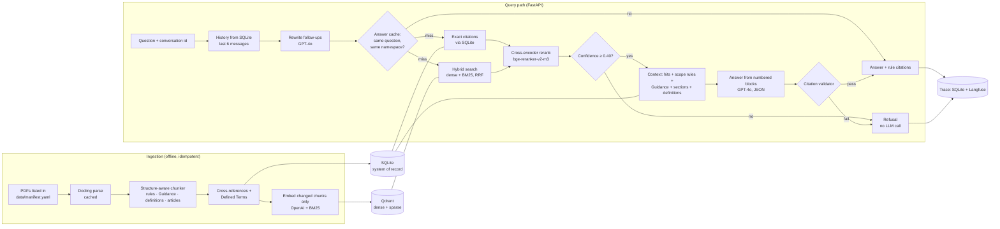

# DFSA Regulatory Compliance Assistant

**Ask a plain-language question about the Dubai Financial Services Authority (DFSA) Rulebook and the DIFC Laws, and get an answer grounded in the exact rule, with a rule-level citation. When the corpus doesn't support a confident answer, it says so instead of guessing.**

A production-style retrieval-augmented generation (RAG) system, built end to end: structure-aware PDF ingestion, hybrid search with cross-encoder reranking, grounded generation with a citation validator, a calibrated refusal gate, conversation memory with query rewriting, an answer cache that was measured before it was trusted, a FastAPI service, full tracing and cost tracking, and an evaluation suite whose results gate every prompt release.

**Read more:** [architecture](docs/architecture.md) · [case study](docs/WRITEUP.md) · [build log](docs/ROADMAP.MD)


---

## What it does

In compliance work, a wrong or unsupported answer is worse than no answer. So the requirement is precision: retrieve the right provision, cite it exactly, and refuse when the evidence isn't there.

**An answer.** The answer depends on a scope rule, not on the rule that sets the requirement:

> **Q:** Do we need a Client Agreement with a Market Counterparty?
>
> **A:** No, a Client Agreement is not required when dealing with a Market Counterparty. The Rules in COB section 3.3, which include the requirement for a Client Agreement, do not apply to an Authorised Firm when carrying on a Financial Service with or for a Market Counterparty (COB 3.3.1(a)).
>
> *Cited:* COB 3.3.1 · GLO Client Agreement · GLO Market Counterparty

Plain hybrid search ranks COB 3.3.1 12th. The cross-encoder reranker puts it 1st.

**A refusal, decided before any LLM call:**

> **Q:** What does COB 99.9.9 require?
>
> **A:** I don't have a confident answer to this from the DFSA Rulebook and DIFC Laws I can search. […] COB 99.9.9 is not in the documents I can search.

The best reranker score for "What is the VAT rate in the UAE?" is 0.003, against 0.40 or more for answerable questions. The confidence gate refuses it without spending a single generation token.

**Follow-ups work.** "What if the client is a Market Counterparty?" is rewritten from the conversation history into a standalone query before retrieval. Both the original and the rewritten question are logged.

---

## Highlights

- **Structure-aware ingestion.**
  - Docling parses the PDFs. Each Rulebook rule, Guidance note, definition and Law article becomes **one chunk**. Long rules are split only at sub-rule boundaries.
  - Every chunk is stored with its heading path, cross-references and Defined Terms.
  - Docling's output needed fixing:
    - its reading order was wrong on 89 of 244 COB pages;
    - it mislabelled real FPR rule pages as a table of contents;
    - it moved rule numbers into a separate field.
  - The chunker rebuilds the hierarchy from the rule numbers instead.
- **Hybrid retrieval with reranking, measured.**
  - Dense (`text-embedding-3-small`) and BM25 search run in one batched Qdrant request, fused client-side with reciprocal rank fusion (RRF).
  - A cross-encoder (`bge-reranker-v2-m3`, on the GPU in fp16) re-scores 40 candidates.
  - Every stage's contribution is measured on the golden set, not assumed (see [Results](#results)).
- **An exact-citation path.** "What does COB 3.3.2 require?" resolves COB 3.3.2 directly through SQLite. Embeddings blur numbers, and BM25 splits `3.3.2` into `3 3 2`.
- **Context assembly.** The LLM sees each hit together with:
  - its scope rules ("does not apply to…"),
  - its Guidance,
  - its parent section, within a token budget,
  - the Defined Terms the question uses.

  One context block is one provision, labelled binding or non-binding.
- **Grounded generation with a citation validator.**
  - GPT-4o answers only from numbered context blocks.
  - Code then checks that every cited block exists and carries that citation, and that every provision the answer *mentions* is a listed block or a reference quoted from one.
  - A failed check means a refusal, never a patched answer.
- **A calibrated refusal gate.** The top reranker score is the confidence signal. Its threshold (0.40) was chosen on the golden set: it refuses all 10 unanswerable questions and wrongly refuses 1 of 54 answerable ones.
- **An eval-gated release process.**
  - A hand-reviewed golden set: 59 conversations, 64 turns, covering every module, Laws terms, exemptions, follow-ups and unanswerable questions.
  - Retrieval metrics plus two LLM judges.
  - A prompt version can be promoted to production only if an end-to-end eval run of **exactly that content** passed the floors and the regression checks.
- **Observability from day one.**
  - Every request is one Langfuse trace (rewrite → retrieve → embed → answer → generation → citation check), linked to the prompt versions it used.
  - A slim audit row in SQLite ties each stored answer to its retrieved chunks, scores, tokens, cost and latency.
- **Idempotent ingestion.** Per-chunk content hashes mean only changed chunks are re-embedded: an unchanged re-run costs $0.00. The index plan is diffed against Qdrant's own points, so crashes and lost collections repair themselves.
- **An answer cache, measured before it was trusted.**
  - A repeated question (including a follow-up whose rewrite matches) is served in about 5 ms at $0, instead of 5–8 s and about $0.02.
  - Entries are namespaced by corpus, prompt, retrieval config, model and filters, so any change makes old answers unreachable.
  - A semantic (similarity) layer was built and evaluated on hard negatives, then left off: no threshold separated paraphrases from near-misses with different answers (see [Results](#results)).
- **Cost reporting across all spend.** `scripts/cost_report.py` splits production, eval and ingestion spend by provider, with refusal and cache-hit rates per day.

---

## Results

All numbers are from the reviewed golden set: 59 conversations, 64 turns, 54 of them answerable.

### Retrieval: what each stage adds

| Configuration | Recall@1 | Recall@6 | Recall@40 | MRR | nDCG@6 | Context recall | Retrieval p50 |
|---|---|---|---|---|---|---|---|
| Dense only | 0.630 | 0.852 | 0.963 | 0.740 | 0.781 | 0.963 | 0.44 s |
| BM25 only | 0.435 | 0.778 | 0.982 | 0.578 | 0.604 | 0.880 | 0.02 s |
| Hybrid (dense + BM25, RRF) | 0.565 | 0.852 | 0.982 | 0.692 | 0.726 | 0.907 | 0.44 s |
| **Hybrid + bge-reranker-v2-m3** (production) | **0.796** | **0.944** | **0.982** | **0.877** | **0.841** | **0.982** | 1.41 s |
| Hybrid + bge-reranker-base | 0.667 | 0.917 | 0.982 | 0.792 | 0.783 | 0.972 | 1.05 s |
| Hybrid + ms-marco-MiniLM-L6 | 0.593 | 0.907 | 0.982 | 0.726 | 0.741 | 0.944 | 0.63 s |
| Production, without parent expansion | 0.796 | 0.944 | 0.982 | 0.877 | 0.841 | 0.963 | — |

*Recall@k: share of gold provisions in the top k. Context recall: share of gold provisions among the blocks actually sent to the LLM. Retrieval latency includes the query embedding and, for reranked rows, cross-encoder scoring of 40 candidates on an RTX 3050 laptop GPU (fp16).*

- **The reranker is the largest single gain:**
  - MRR 0.69 → 0.88;
  - the right provision comes first 80% of the time, against 57% for hybrid search alone.
- **The largest reranker wins:** `bge-reranker-v2-m3` beats both smaller models. Its cost is about 1 s of latency.
- **Hybrid fusion alone ranks worse than dense at the top** (MRR 0.69 vs 0.74). Its value is a wider candidate pool (recall@20: 0.963 vs 0.907), which the reranker then exploits.
- **Parent expansion and the scope-rule policy matter for exemption questions.** "Do we need a suitability assessment for an execution-only trade?" depends on COB 3.4.1, which is never retrieved. It reaches the LLM only because scope rules are always added to the context.

### End to end (e2e eval run #14, production configuration)

| Faithfulness | Relevance (1–5) | Citation recall | False refusals | Unanswerable refused | Citation-check refusals | Turn latency p50 / p95 | Cost per turn |
|---|---|---|---|---|---|---|---|
| 0.995 | 4.94 | 0.981 | 2 / 54 | **10 / 10** | 1 / 64 | 4.7 s / 7.3 s | $0.027 (incl. judges) |

- **Faithfulness** is the share of an answer's claims that the context blocks support, as judged by an LLM. **Relevance** is judged by a second LLM judge. Both judge prompts are versioned like the answer prompt.
- **The judges caught real defects** that the deterministic checks can't:
  - an answer that cited the right rule (AML 6.1.1) but reversed its meaning;
  - an answer about listed *funds* when the question asked about listed *companies*.
- **An answer costs about $0.013–0.02**, almost all of it GPT-4o input tokens. Embedding the whole corpus cost **$0.012**.

### The answer cache: why it matches exact repeats only

A semantic cache serves a stored answer when a new question's embedding is close enough to a cached one. In compliance work, a near-identical question can have the opposite answer. The cache eval (`src/eval/cache_eval.py`) measured this on 32 paraphrases and 32 hard negatives drafted from the golden set:

| Similarity threshold | Similarity only: wrong answers served | Paraphrases served |
|---|---|---|
| 0.80 (LiteLLM's documented example) | 17 / 32 | 100% |
| 0.90 (RedisVL's default distance of 0.1) | 6 / 32 | 75% |
| 0.95 | 4 / 32 | 22% |

- **Guards help, but can't close the gap.** The guards (the same provisions, Defined Terms and numbers) stop 17 of the 32 negatives, but not those where the decisive word is ordinary. "Minimum margin for a CFD on a **major** currency pair" vs "… a **minor** currency pair" scores **0.978**, while real paraphrases score 0.83–0.98.
- **No safe threshold exists:** any threshold that serves no wrong answer serves no paraphrase.
- **The cache matches exact repeats only.** It still catches follow-ups whose rewrite matches a cached question, which in the live check cut such a turn from about 5 s to 1.5 s. The semantic layer and its eval stay in the code, gated at 0 false hits.

---

## Architecture



**Responsibilities:**
- **SQLite** holds every chunk, including the ones never embedded (section parents, split rules, deleted provisions). It also holds the cross-references and Defined Terms, conversations, request traces, eval runs and cached answers.
- **Qdrant** holds only the embedded chunks. A point's id is its SQLite row id.
- **Langfuse** (self-hosted) is where traces are viewed. It also stores prompt versions and labels, and the golden set as a dataset.

### Key design decisions

| Decision | Why |
|---|---|
| One chunk per rule or sub-rule, not fixed-size windows | Precise citations; a parent section is attached afterwards for context |
| Hierarchy rebuilt from rule numbers, not from Docling's labels | Docling's reading order and labels proved unreliable on these PDFs |
| Exact citation hits pinned first | A question that names a provision always gets that provision |
| Scope rules always added to the context | "Does not apply to …" rules change answers, but they rarely rank on their own |
| One embedding config, fingerprinted into the collection name | Queries and documents can't silently use different models; a model change means a new collection |
| BM25 `avg_len` measured on the corpus (124, not 256) | The default under-penalises long chunks |
| Reranker pinned to a Hugging Face commit and loaded offline | Eval results can't shift because a model changed upstream |
| Prompts live in git and are synced to Langfuse; production only from committed files | A rollback is a git revert; an outage falls back to the git copy |
| Answer cache keyed on the exact question within a namespace of corpus, prompt, config and filters | Measured: similarity can't tell "major" from "minor"; a stale answer can't be served after any change |
| An outage is an error (503), not a refusal | "No confident answer" would misdescribe a broken dependency |

---

## Tech stack

| Layer | Choice |
|---|---|
| Generation | Azure OpenAI **GPT-4o** (JSON mode) |
| Embeddings | OpenAI **text-embedding-3-small** (1,536 dimensions) |
| Sparse retrieval | BM25 via fastembed (`Qdrant/bm25`) |
| Reranker | **BAAI/bge-reranker-v2-m3** (sentence-transformers `CrossEncoder`, CUDA fp16) |
| Vector store | **Qdrant** 1.19 (hybrid dense + sparse, payload filtering) |
| Relational store | **SQLite** (WAL) + SQLAlchemy + Alembic |
| PDF parsing | **Docling** |
| Serving | **FastAPI** |
| Tracing, prompts, datasets | **Langfuse** v4, self-hosted |
| Tooling | Python 3.12, uv, pytest (452 tests), Ruff, Docker Compose |

## Corpus

- 11 source documents:
  - 6 DFSA Rulebook modules: GEN, COB, AML, MKT, FPR and the Glossary (GLO);
  - 5 DIFC Laws: Regulatory, Markets, Collective Investment, Investment Trust, and Islamic Financial Business.
- **4,060 chunks**, of which **3,397 are embedded**: rules, Guidance, definitions and Law articles.
- **2,114 cross-references** extracted, and 97% of chunks tagged with the Defined Terms they use.
- The reference check also found two typos in the source PDFs: COB cites a non-existent "Rule 16.6.4", and GEN cites "A2.3.2" where it means A2.3.1.

> **The source PDFs are not in this repository** (copyright). They are downloaded manually, once, and listed with their SHA-256 hashes in `data/manifest.yaml`. The project never scrapes or crawls the regulators' sites: their `robots.txt` disallows it.

---

## Getting started

**Prerequisites:**
- Python 3.12 and [uv](https://docs.astral.sh/uv/)
- Docker
- An Azure OpenAI GPT-4o deployment and an OpenAI API key
- An NVIDIA GPU for the reranker (optional: it runs on CPU, much slower)

```bash
# 1. Dependencies and configuration
uv sync
cp .env.example .env            # Azure OpenAI, OpenAI, Qdrant and API keys
uv run python -m scripts.init_langfuse_env --email you@example.com   # Langfuse secrets (once)

# 2. Qdrant + Langfuse (UI at http://127.0.0.1:3000)
docker compose -f infra/docker-compose.yml --env-file .env up -d

# 3. Database
uv run alembic upgrade head

# 4. Corpus: put the PDFs listed in data/manifest.yaml under data/raw/, then
uv run python -m src.ingestion.ingest --dry-run      # plan + cost estimate, writes nothing
uv run python -m src.ingestion.ingest                # parse, chunk, embed (~$0.012)
uv run python -m src.ingestion.ingest --reconcile    # SQLite and Qdrant agree?

# 5. Prompts into Langfuse
uv run python -m scripts.sync_prompts
```

### Ask from the command line

```bash
uv run python -m scripts.ask "Do we need a Client Agreement with a Market Counterparty?"
uv run python -m scripts.ask "what about retail clients?" --conversation <id>   # a follow-up
uv run python -m scripts.retrieve "customer due diligence" --module AML --json   # retrieval only, every stage
```

### Cost and cache

```bash
uv run python -m scripts.cost_report --days 30     # production, evals, ingestion; by provider; cache hit rate
uv run python -m scripts.cache stats               # cached answers, hits served
uv run python -m scripts.cache purge               # drop expired entries and those from an old namespace
```

### Run the API

```bash
uv run uvicorn src.api.app:app --host 127.0.0.1 --port 8000
```

| Endpoint | Purpose |
|---|---|
| `GET /health` | Database, Qdrant, reranker, cache and Langfuse status (no key needed) |
| `POST /conversations` | Start a conversation |
| `POST /conversations/{id}/messages` | Ask; returns the answer, citations, refusal reason, rewritten query, trace id, cost, latency, and whether it was served from the cache (with the trace that first produced it) |
| `GET /conversations/{id}` | The conversation with its stored messages |
| `GET /traces/{trace_id}` | The audit record: candidates with scores, prompts used, tokens, cost |
| `GET /stats/cost` | Cost by stage and provider, tokens, refusals by reason, latency, cache hit rate; per day; `?since=&until=` |

Every endpoint except `/health` needs an `X-API-Key` header. The server loads conversation history from SQLite and never trusts history sent by the client.

```bash
curl -s -X POST http://127.0.0.1:8000/conversations -H "X-API-Key: $API_KEY"
curl -s -X POST http://127.0.0.1:8000/conversations/<id>/messages -H "X-API-Key: $API_KEY" \
  -H "Content-Type: application/json" -d '{"content": "When must we carry out CDD on a new customer?"}'
```

---

## Evaluation and the release gate

```bash
uv run python -m src.eval.golden --check          # golden set: schema + every gold provision exists
uv run python -m src.eval.run --retrieval-only --configs dense,hybrid,hybrid_rerank   # < $0.01
uv run python -m src.eval.run                     # end to end + LLM judges + gate (~$1.70)
uv run python -m src.eval.calibrate               # refusal threshold from stored confidences
uv run python -m src.eval.gate --run latest       # re-check a stored run, exit 1 on failure
uv run python -m scripts.sync_dataset             # golden set -> Langfuse dataset
uv run python -m src.eval.cache_eval              # answer cache: hard negatives, naive vs guarded sweep, gate
```

- **Golden set** (`data/eval/golden.yaml`):
  - Gold labels are **provision ids** ("COB 3.3.2", "GLO Retail Client", "Regulatory Law Art. 70"), not chunk ids, so they survive re-ingestion.
  - Each label is graded: gold (must be retrieved) or supporting.
- **Metrics:**
  - recall@1/3/6/20/40, MRR and nDCG@6, plus **context recall**: whether the gold provision reached the LLM through parent expansion even when it wasn't a hit;
  - refusal recall and false-refusal rate;
  - citation precision and recall;
  - citation-check failures;
  - p50/p95 latency per stage, and cost.
- **Releasing a prompt change:**
  1. Edit `prompts/answer.yaml`.
  2. `sync_prompts` creates a new Langfuse version, labelled `staging`.
  3. Run `src.eval.run --label staging`.
  4. Commit the prompt file.
  5. Run `promote_prompt answer`. Production moves only if the newest e2e run of that exact content passed `eval/thresholds.yaml` (floors, ceilings, and at most 3% regression against the last passing run).

---

## Project layout

```
data/manifest.yaml          the corpus: one entry per source PDF, with its hash
data/eval/golden.yaml       the golden Q&A set
eval/thresholds.yaml        release-gate floors and ceilings
data/eval/cache_pairs.yaml  answer-cache calibration pairs (paraphrases and hard negatives)
prompts/                    answer, refusal, query-rewrite and two judge prompts (versioned)
infra/docker-compose.yml    Qdrant + Langfuse (web, worker, Postgres, ClickHouse, Redis, MinIO)
src/
  config/        settings: one section per provider; the single embedding config
  ingestion/     manifest, Docling parse, chunkers (Rulebook, Glossary, Laws), refs, ingest, reconcile
  embeddings/    the one embedding client (ingestion and queries), the BM25 encoder
  storage/       SQLite models, repositories, Alembic migrations, the Qdrant store
  retrieval/     citation router, hybrid search, reranker, context assembly, pipeline
  generation/    the GPT-4o client, the answerer, the citation validator
  chat/          query rewriting, the answer cache, ChatService (history, one trace per turn)
  prompts/       prompt files, Langfuse sync, the registry with git fallback
  eval/          golden set, metrics, judges, runner, calibration, gate, dataset
  api/           FastAPI app and schemas
scripts/                    command-line tools (ask, retrieve, cost_report, cache, inspect_store, sync/promote prompts, ...)
tests/                      452 tests: offline fakes, plus `-m corpus` tests against the live index
docs/                       architecture.md, WRITEUP.md (case study), ROADMAP.MD (build log), langfuse-setup.md
```

## Limitations

- **The judges share the generator's model** (GPT-4o judges GPT-4o), so same-model bias is possible.
- **The golden set is small and was drafted by an LLM.** Its 64 turns were drafted from the corpus by an LLM and reviewed by the project owner. The refusal threshold is calibrated on the same set it is evaluated on, with thin margins.
- **Some known answer issues remain:**
  - one answer still reverses AML 6.1.1 (risk assessment before CDD);
  - the listed-company inside-information rule (MKT 4.2.1) is outranked by the listed-fund rule (MKT 6.5).
- **Follow-up rewrites vary between runs**, even at temperature 0. This is the main source of run-to-run noise in multi-turn evals.
- **Corpus updates are manual:** re-download, then re-run. The hash-based ingest re-embeds only what changed.
- **The answer cache only catches exact repeats.** Its calibration pairs were also drafted by an LLM from the golden set.

## Roadmap

- [x] Ingestion, storage, hybrid retrieval and reranking, grounded generation, chat API, tracing, evaluation and release gate
- [x] Cost reporting across all spend; an answer cache with a tracked hit rate (exact repeats, by measurement)
- [ ] Web UI: chat with inline citations, rule viewer, trace inspector
- [ ] An equivalence check (LLM or cross-encoder) that could make semantic cache hits safe
- [ ] VARA (Dubai's virtual-asset regulator) as a second regulator, filterable per question

The full build log, with the findings and decisions behind each phase, is in [`docs/ROADMAP.MD`](docs/ROADMAP.MD).

---

*Not legal advice. Answers are generated from a fixed snapshot of the DFSA Rulebook and DIFC Laws; check the current official text before relying on them.*
